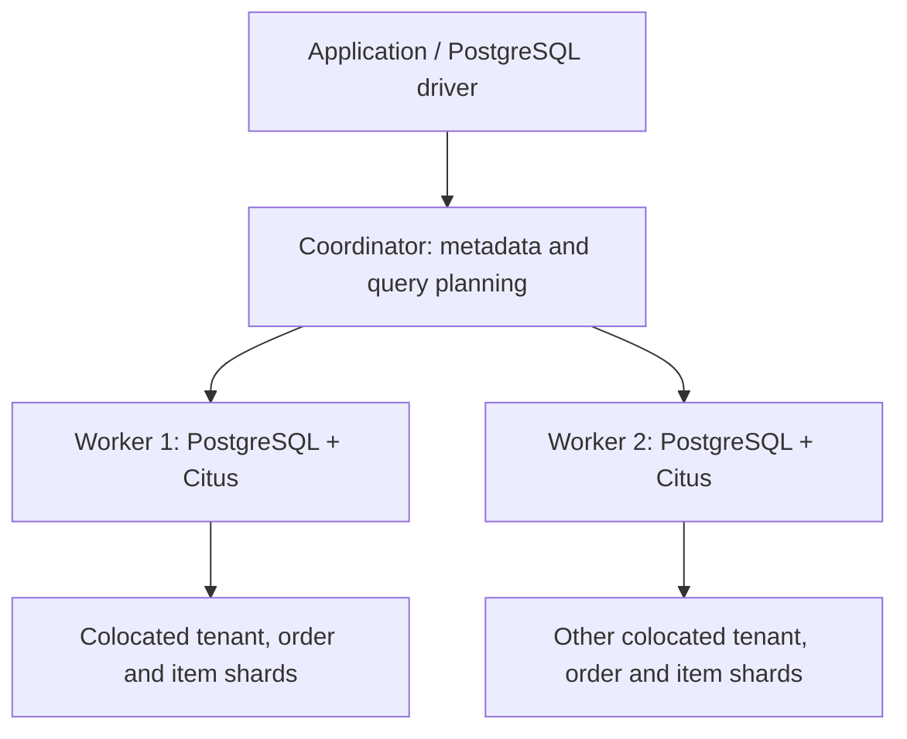

# 025 — Citus: Horizontal Scaling and Distributed PostgreSQL

[Contents and learning path](../README.md) | [Persian version](01_025_citus_distributed_postgresql_Persian.md)

## Learning Goals

Recognize appropriate Citus workloads, select a distribution column, colocate related tables, and use a multi-node cluster through PostgreSQL SQL. Prerequisites: primary and foreign keys, indexes, transactions, partitioning, and replication.

Examples target **Citus 13.0** as a documented teaching baseline, not as a claim about the latest release. Keep PostgreSQL and Citus versions compatible and coordinated across nodes.

## 1. What Citus adds

**Citus is a PostgreSQL extension that distributes selected data and query execution across nodes.** Tables are divided into shards so storage, CPU, and I/O need not remain concentrated on one server.

Applications retain the PostgreSQL protocol, drivers, and tools such as `psql`. Distributed execution still requires deliberate schema and query design. Enabling the extension does not automatically distribute existing tables. See [Citus Concepts](https://docs.citusdata.com/en/v13.0/get_started/concepts.html).

Consider a service hosting thousands of independent shops. Most requests access one shop's orders and items. Distribution by shop identifier can spread shops across workers while keeping ordinary requests local to one worker.

## 2. Useful workloads and selection criteria

| Workload | Potential benefit | Question to answer first |
| --- | --- | --- |
| Multi-tenant SaaS | Requests naturally belong to an account | Do most queries include `tenant_id`? |
| Real-time dashboards | Workers can calculate partial aggregates | How much data must move between nodes? |
| Events and IoT | Device/account identifiers can distribute load | Is the chosen key diverse and balanced? |
| Large time-series datasets | Entity distribution complements time partitioning | Are retention and recent-data queries designed well? |

These are patterns, not performance guarantees. Optimize ordinary PostgreSQL first when the actual problem is a missing index, an inefficient query, or a small dataset. Choose Citus using measured bottlenecks, access patterns, and operational cost. See [Choosing Distribution Column](https://docs.citusdata.com/en/v13.0/sharding/data_modeling.html).

## 3. Partitioning, replicas, Patroni, and Citus

| Mechanism | Main responsibility | Relationship to Citus |
| --- | --- | --- |
| Native partitioning | Split a table logically, for example by month | Does not itself distribute data across servers; can complement Citus |
| Read replica | Maintain another copy for reads or recovery | Does not itself distribute independent writes across primaries |
| Patroni | Manage PostgreSQL HA and failover | Not a sharding system; HA can be designed alongside Citus |
| Citus | Distribute tables and execute distributed SQL | Horizontal capacity with separate HA and recovery requirements |

Two workers do not imply two copies of each row. In this lab they hold different shards. Losing one worker is not automatically repaired by the other having identical data. Plan replication and recovery separately. See [Cluster Management](https://docs.citusdata.com/en/v13.0/admin_guide/cluster_management.html).

## 4. Coordinator, workers, and shards



The lesson uses the coordinator connection path. It tracks shard locations, routes or parallelizes queries, and returns results. Workers store shards and execute their portions of the work.

Many tenants can share one shard. Hash distribution maps key values to hash ranges, not tenant numbers directly to worker numbers. This simplified path does not imply that Citus has no other connection capabilities. See [Citus Concepts](https://docs.citusdata.com/en/v13.0/get_started/concepts.html).

## 5. Table types used in the example

| Type | Behavior | Example |
| --- | --- | --- |
| Distributed | Rows are assigned to shards by a key | Tenant orders |
| Reference | A small shared dataset is replicated to workers | Order status definitions |
| Local | An ordinary PostgreSQL table on its original node | Local data; distributed joins need evaluation |

Reference tables have replication and write-coordination costs. They are not the default for large tables or a universal solution to global uniqueness. See [Distributed DDL](https://docs.citusdata.com/en/v13.0/develop/reference_ddl.html).

## 6. Distribution keys and colocation

The example uses `tenant_id` for `tenants`, `orders`, and `order_items`, with matching types and explicit colocation. Colocation places matching shards together so related tenant work can stay on one worker.

A good key matches important filters and joins while distributing load. A low-cardinality status column creates few active destinations. A heavily used value can create a hotspot. One large tenant is not automatically spread across every worker by hashing its identifier.

For time-series designs, consider distributing by entity and partitioning by time. Hashing timestamps does not preserve adjacent time ranges. See [Distribution Column Design](https://docs.citusdata.com/en/v13.0/sharding/data_modeling.html).

## 7. Adding Citus to PostgreSQL

1. Install a compatible PostgreSQL/Citus package or image on the coordinator and workers.
2. Add `citus` to `shared_preload_libraries` and restart PostgreSQL, preserving other required entries such as `pg_stat_statements`.
3. Configure the target database, network reachability, and inter-node authentication.
4. Enable the extension in the target database on every node.
5. Register workers and explicitly distribute selected tables.

```sql
CREATE EXTENSION IF NOT EXISTS citus;
SELECT citus_version();
```

This SQL does not install extension binaries. The chapter's existing `pgvector/pgvector:pg16` image does not itself supply Citus. The new lab is separate. See [Multi-node installation](https://docs.citusdata.com/en/v13.0/installation/multi_node_rhel.html).

## 8. Independent Windows/Docker lab

The [lab directory](./_lab/) contains:

- [compose.yaml](./_lab/compose.yaml): one coordinator and two workers using `citusdata/citus:13.0`.
- [01_cluster.sql](./_lab/01_cluster.sql): registration and version inspection.
- [02_demo.sql](./_lab/02_demo.sql): schema, sample data, queries, plans, and shard inspection.

Requirements: Docker Desktop running Linux containers and Compose with `--wait` support. Open Command Prompt in `025_citus_distributed_postgresql` and run in order:

```bat
cmd /c docker compose -f _lab/compose.yaml config --quiet
cmd /c docker compose -f _lab/compose.yaml up -d --wait --wait-timeout 60
cmd /c docker compose -f _lab/compose.yaml exec -T worker1 psql -U postgres -d citus_lab -v ON_ERROR_STOP=1 -c "CREATE EXTENSION IF NOT EXISTS citus;"
cmd /c docker compose -f _lab/compose.yaml exec -T worker2 psql -U postgres -d citus_lab -v ON_ERROR_STOP=1 -c "CREATE EXTENSION IF NOT EXISTS citus;"
cmd /c docker compose -f _lab/compose.yaml exec -T coordinator psql -U postgres -d citus_lab -v ON_ERROR_STOP=1 -f /lesson/01_cluster.sql
cmd /c docker compose -f _lab/compose.yaml exec -T coordinator psql -U postgres -d citus_lab -v ON_ERROR_STOP=1 -f /lesson/02_demo.sql
```

On a startup timeout, inspect `docker compose -f _lab/compose.yaml ps` and `logs --tail 50`, prefixed with `cmd /c`. Run the demo once on a fresh database. Repeating it stops at the existing schema rather than deleting data. Mid-script failures can leave partial setup because the file is not one transaction.

Optional host connection: host `127.0.0.1`, port `55432`, database `citus_lab`, user `postgres`. Worker names resolve inside Compose, not as Windows hostnames.

This local lab enables `trust` authentication for simplicity; the example password does not enforce authentication. Only the coordinator port is published, bound to loopback. Production needs restricted authentication, TLS, a non-superuser application role, and a reviewed patch version or image digest. The official image is intended for development/testing: [Docker installation](https://docs.citusdata.com/en/v13.0/installation/single_node_docker.html).

Stop without requesting volume deletion:

```bat
cmd /c docker compose -f _lab/compose.yaml down
```

## 9. Creating and distributing tables

This is an explanatory excerpt from the demo, not another step to run after the complete file. The tenant table anchors the colocation group:

```sql
CREATE TABLE citus_demo.tenants (
    tenant_id bigint PRIMARY KEY,
    tenant_name text NOT NULL
);

SELECT create_distributed_table(
    'citus_demo.tenants',
    'tenant_id',
    colocate_with => 'none'
);

CREATE TABLE citus_demo.orders (
    tenant_id bigint NOT NULL,
    order_id bigint NOT NULL,
    status_code text NOT NULL,
    total_amount numeric(12, 2) NOT NULL CHECK (total_amount >= 0),
    created_at timestamptz NOT NULL DEFAULT now(),
    PRIMARY KEY (tenant_id, order_id)
);

SELECT create_distributed_table(
    'citus_demo.orders',
    'tenant_id',
    colocate_with => 'citus_demo.tenants'
);
```

The order primary key includes the distribution column. A key on `order_id` alone cannot enforce global uniqueness for this hash-distributed model and is unsupported here. Different tenants may reuse order IDs, while the pair stays unique. The item-to-order foreign key likewise includes both columns. See [Distributed constraints](https://docs.citusdata.com/en/v13.0/develop/reference_ddl.html).

A previously created shared table can become a reference table:

```sql
SELECT create_reference_table('citus_demo.order_statuses');
```

See [Citus Utility Functions](https://docs.citusdata.com/en/v13.0/develop/api_udf.html) for arguments.

## 10. Tenant queries, joins, and cross-tenant reports

Retrieve one tenant's orders:

```sql
SELECT order_id, total_amount
FROM citus_demo.orders
WHERE tenant_id = 10
ORDER BY order_id;
```

Expected: order `1001` totals `120.00`; order `1002` totals `80.00`. Keep tenant equality explicit in joins:

```sql
SELECT orders.order_id,
       sum(items.quantity * items.unit_price) AS calculated_total
FROM citus_demo.orders AS orders
JOIN citus_demo.order_items AS items
    ON items.tenant_id = orders.tenant_id
   AND items.order_id = orders.order_id
WHERE orders.tenant_id = 10
GROUP BY orders.order_id
ORDER BY orders.order_id;
```

Omitting tenant equality can join different tenants with the same order ID incorrectly. Distribution determines placement, not authorization. Derive the permitted tenant from trusted identity and enforce access controls in the data-access path, with isolation tests.

Cross-tenant reporting remains possible but can involve more distributed work:

```sql
SELECT tenant_id, sum(total_amount) AS total_amount
FROM citus_demo.orders
GROUP BY tenant_id;
```

Expected: `200.00` for tenant `10`, `50.00` for tenant `20`. See [Multi-tenant tutorial](https://docs.citusdata.com/en/v13.0/get_started/tutorial_multi_tenant.html).

## 11. Inspecting plans and placement

```sql
EXPLAIN (ANALYZE, BUFFERS)
SELECT order_id, total_amount
FROM citus_demo.orders
WHERE tenant_id = 10;

SELECT logicalrelid::regclass AS table_name, colocationid
FROM pg_dist_partition
WHERE logicalrelid::regclass::text LIKE 'citus_demo.%';

SELECT table_name, shardid, nodename, nodeport, shard_size
FROM citus_shards
WHERE table_name::text LIKE 'citus_demo.%';
```

Inspect tasks, workers, and data movement. Plan formatting depends on version and settings. A tenant equality filter should allow pruning to its shard; all-tenant aggregation can visit multiple shards. `EXPLAIN ANALYZE` executes the statement; these examples use only `SELECT`.

The demo's eight shards per distributed table are a teaching choice, not production sizing. Shard count differs from worker count, and three orders are not a benchmark. See [Citus Tables and Views](https://docs.citusdata.com/en/v13.0/develop/api_metadata.html).

## 12. Growth, limitations, and operations

Registering a worker with `citus_add_node` does not move existing shards. Rebalance separately after reviewing disk headroom, network capacity, replica identity, and transfer policy. Citus 13 offers functions such as `citus_rebalance_start` and `citus_rebalance_wait`; check installed-version arguments and behavior. See [Cluster Management](https://docs.citusdata.com/en/v13.0/admin_guide/cluster_management.html).

Evaluate these before migration:

- Constraints against the distribution and colocation design.
- Cross-node transactions and nonlocal joins instead of assuming single-node behavior transfers unchanged.
- Version-specific SQL limits: Citus 13 documents `SELECT ... FOR UPDATE` for single-shard queries, not general cross-node queries.
- ORM migrations, coordinator-to-worker connections, and realistic concurrent load.
- HA and tested recovery covering worker data and coordinator metadata/state; a coordinator dump alone does not establish a complete backup.

See [SQL Support and Workarounds](https://docs.citusdata.com/en/v13.0/develop/reference_workarounds.html). Citus does not remove transactions; this model minimizes multi-node coordination in ordinary tenant requests.

## 13. Alternative: schema-based sharding

For an application already using one schema per tenant, evaluate schema-based sharding. This alternative is not part of the row-based lab:

```sql
CREATE SCHEMA tenant_alpha;
SELECT citus_schema_distribute('tenant_alpha');
```

Schema tables form a related group for placement and movement. Do not apply this blindly to the preceding schema with distributed/reference tables. Check cross-schema foreign-key and query restrictions. See [Creating and Distributing Schemas](https://docs.citusdata.com/en/v13.0/develop/reference_ddl.html#creating-and-distributing-schemas).

## 14. Exercises and answers

**Exercise 1:** Why is a two-value order status a poor key? **Answer:** Low cardinality limits destinations, risks imbalance, and does not match tenant access.

**Exercise 2:** Why do primary and foreign keys include `tenant_id`? **Answer:** They express tenant-scoped identity and fit distributed constraints and colocated joins.

**Exercise 3:** A third worker does not accelerate an existing report. What should you inspect? **Answer:** Existing shards may not have moved. Check placement and plans; registration differs from rebalancing.

**Exercise 4:** One tenant produces half the traffic. Why might tenant hashing be insufficient? **Answer:** Its rows remain together in their shard; large-tenant handling or the distribution model needs more design.

**Exercise 5:** Does a successful demo prove Citus is necessary? **Answer:** No. Compare latency, throughput, joins, cost, and failure behavior against a well-designed single-node deployment.

## Official References

- [Citus Concepts](https://docs.citusdata.com/en/v13.0/get_started/concepts.html)
- [Distribution Column Design](https://docs.citusdata.com/en/v13.0/sharding/data_modeling.html)
- [Multi-tenant Tutorial](https://docs.citusdata.com/en/v13.0/get_started/tutorial_multi_tenant.html)
- [Distributed DDL and Constraints](https://docs.citusdata.com/en/v13.0/develop/reference_ddl.html)
- [Citus Utility Functions](https://docs.citusdata.com/en/v13.0/develop/api_udf.html)
- [Metadata Tables and Views](https://docs.citusdata.com/en/v13.0/develop/api_metadata.html)
- [SQL Support and Workarounds](https://docs.citusdata.com/en/v13.0/develop/reference_workarounds.html)
- [Cluster Management](https://docs.citusdata.com/en/v13.0/admin_guide/cluster_management.html)
