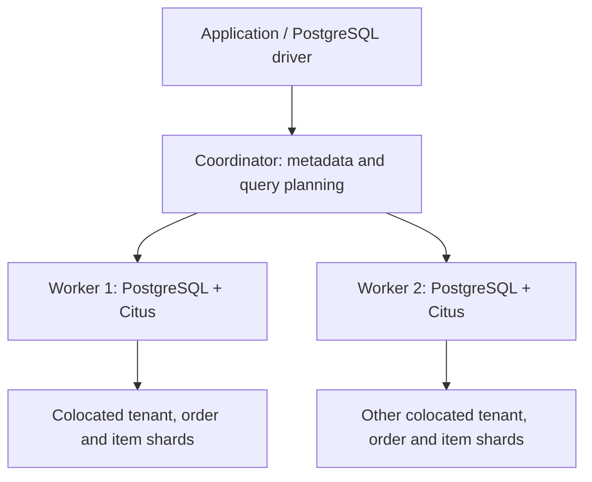

<div dir="rtl">

[← فهرست و مسیر یادگیری](../README.md) | [English Version](01_025_citus_distributed_postgresql_English.md)

# 025 — Citus: مقیاس‌پذیری افقی و PostgreSQL توزیع‌شده

## هدف یادگیری

پس از این درس می‌توانید تشخیص دهید Citus برای چه مسئله‌ای مناسب است، جدول‌های مرتبط را با کلید توزیع درست طراحی کنید و یک نمونهٔ چندنودی را با SQL معمول PostgreSQL به کار بگیرید. پیش‌نیازها: کلید اصلی و خارجی، ایندکس، تراکنش و تفاوت پارتیشن‌بندی با رپلیکیشن.

مثال‌های این درس بر مبنای **Citus 13.0** نوشته شده‌اند؛ این انتخاب آموزشی، ادعای آخرین نسخه بودن ندارد. نسخهٔ PostgreSQL و Citus باید با یکدیگر سازگار باشند و روی همهٔ نودها یکسان و هماهنگ نگهداری شوند.

## ۱. Citus چیست و چه مسئله‌ای را حل می‌کند؟

**Citus یک افزونهٔ PostgreSQL برای توزیع داده و اجرای کوئری روی چند نود است.** به‌جای اینکه تمام داده، پردازش و I/O روی یک سرور متمرکز بماند، جدول‌های منتخب به shard تقسیم می‌شوند و میان workerها قرار می‌گیرند.

برنامه همچنان با پروتکل PostgreSQL و ابزارهایی مانند `psql` و درایورهای PostgreSQL کار می‌کند. با این حال، توزیع داده نیازمند طراحی آگاهانهٔ مدل و کوئری‌هاست؛ فعال‌کردن افزونه به‌تنهایی تمام جدول‌های موجود را توزیع نمی‌کند. معماری در [مفاهیم Citus](https://docs.citusdata.com/en/v13.0/get_started/concepts.html) توضیح داده شده است.

فرض کنید سرویس فروشگاهی شما هزاران فروشگاه مستقل دارد. بیشتر درخواست‌ها سفارش‌ها و اقلام **یک فروشگاه** را می‌خوانند. با توزیع بر اساس شناسهٔ فروشگاه، داده و بار فروشگاه‌های مختلف می‌تواند میان چند ماشین تقسیم شود، در حالی که درخواست هر فروشگاه تا حد ممکن محلی باقی می‌ماند.

## ۲. کاربردها و زمان مناسب انتخاب

| سناریو | علت مناسب‌بودن احتمالی | پرسش پیش از انتخاب |
| --- | --- | --- |
| SaaS چندمستاجری | درخواست‌ها معمولاً متعلق به یک سازمان یا مشتری‌اند | آیا بیشتر کوئری‌ها `tenant_id` دارند؟ |
| داشبورد و تحلیل نزدیک به زمان واقعی | تجمیع بخشی از داده می‌تواند موازی روی workerها انجام شود | چقدر داده باید بین نودها جابه‌جا شود؟ |
| رویدادها و دادهٔ IoT | توزیع بر اساس دستگاه یا حساب می‌تواند بار را پخش کند | آیا کلید انتخابی متنوع و متوازن است؟ |
| دادهٔ زمانی در مقیاس بالا | ترکیب توزیع بر اساس موجودیت و پارتیشن زمانی | آیا حذف دادهٔ قدیمی و کوئری اخیر به‌خوبی طراحی شده‌اند؟ |

این‌ها الگوهای تصمیم‌گیری‌اند، نه تضمین افزایش سرعت. برای دیتابیس کوچک، کوئری بدِ بدون ایندکس یا سامانه‌ای با joinهای زیاد و نامرتبط، ابتدا PostgreSQL تک‌نودی را بهینه کنید. شاخص تصمیم باید گلوگاه اندازه‌گیری‌شده، الگوی دسترسی و هزینهٔ عملیاتی باشد. الگوهای چندمستاجری و تحلیلی در [راهنمای انتخاب ستون توزیع](https://docs.citusdata.com/en/v13.0/sharding/data_modeling.html) بررسی شده‌اند.

## ۳. تفاوت با Partitioning، Replica و Patroni

| ابزار یا الگو | وظیفهٔ اصلی | رابطه با Citus |
| --- | --- | --- |
| پارتیشن‌بندی داخلی PostgreSQL | تقسیم منطقی جدول، مثلاً بر اساس ماه | به‌تنهایی داده را روی چند سرور توزیع نمی‌کند؛ می‌تواند همراه Citus استفاده شود |
| Read Replica | نسخهٔ کپی برای خواندن یا بازیابی | به‌تنهایی بار نوشتن مستقل را بین چند primary توزیع نمی‌کند |
| Patroni | مدیریت HA و failover برای گروه‌های PostgreSQL | جایگزین sharding نیست؛ معماری HA می‌تواند در کنار Citus طراحی شود |
| Citus | توزیع جدول‌ها و اجرای SQL توزیع‌شده | برای افزایش ظرفیت افقی، با نیازهای جداگانهٔ HA و پشتیبان‌گیری |

**دو worker به معنی دو نسخه از هر ردیف نیست.** در مدل این آزمایشگاه، shardهای متفاوت میان workerها قرار می‌گیرند؛ خرابی یک worker را دیگری خودکار با داشتن همان داده جبران نمی‌کند. رپلیکیشن و بازیابی را جدا طراحی کنید. جزئیات مدیریت نود و خرابی در [Cluster Management](https://docs.citusdata.com/en/v13.0/admin_guide/cluster_management.html) آمده است.

## ۴. معماری Coordinator، Worker و Shard



در مسیر سادهٔ این درس، برنامه به coordinator متصل می‌شود. coordinator محل shardها را می‌داند، کوئری را به نود مناسب می‌فرستد یا میان نودها تقسیم می‌کند و نتیجه را برمی‌گرداند. worker داده و اجرای بخش مربوط به خودش را نگه می‌دارد.

هر tenant الزاماً یک shard اختصاصی ندارد؛ چند tenant می‌توانند در یک shard باشند. در توزیع hash، مقدار کلید به بازهٔ hash مربوط می‌شود، نه اینکه شمارهٔ tenant همان شمارهٔ worker باشد. این مسیر آموزشی به معنی نبود قابلیت‌های اتصال دیگر در Citus نیست. مرجع معماری [Citus Concepts](https://docs.citusdata.com/en/v13.0/get_started/concepts.html) است.

## ۵. سه نوع جدول در مدل این درس

| نوع | محل و رفتار | کاربرد نمونه |
| --- | --- | --- |
| Distributed table | ردیف‌ها بر اساس کلید توزیع در shardها قرار می‌گیرند | سفارش‌های هر tenant |
| Reference table | یک مجموعهٔ کوچک در همهٔ workerها تکرار می‌شود | وضعیت‌های مشترک سفارش |
| Local table | جدول عادی PostgreSQL روی نود محل ساخت | دادهٔ محلی؛ join توزیع‌شدهٔ آن نیازمند بررسی است |

Reference table را برای هر جدول بزرگ انتخاب نکنید؛ تکثیر و هماهنگی نوشتن آن هزینه دارد. این سازوکار راهی برای حل همهٔ نیازهای یکتایی سراسری نیست. تعریف انواع جدول در [Distributed DDL](https://docs.citusdata.com/en/v13.0/develop/reference_ddl.html) آمده است.

## ۶. انتخاب کلید توزیع و Co-location

در مثال ما کلید توزیع `tenant_id` است. جدول‌های `tenants`، `orders` و `order_items` با همین نوع داده و گروه co-location مرتبط ساخته می‌شوند. **Co-location** یعنی shardهای متناظر جدول‌های مرتبط کنار هم قرار بگیرند تا join و تراکنشِ درون یک tenant تا حد ممکن به یک نود محدود شود.

کلید مناسب باید با فیلترها و joinهای اصلی سازگار باشد و بار را به‌خوبی پخش کند. توزیع بر اساس ستون کم‌تنوعی مثل `status`، یا انتخاب کلیدی که یک مقدار بسیار پرترافیک دارد، می‌تواند hotspot بسازد. در hash sharding، یک tenant بسیار بزرگ نیز خودبه‌خود میان همهٔ workerها پخش نمی‌شود.

برای دادهٔ زمانی، معمولاً شناسهٔ موجودیت را برای توزیع و زمان را برای پارتیشن‌بندی بررسی کنید؛ hash کردن timestamp، بازه‌های زمانی را کنار هم نگه نمی‌دارد. راهنمای اصلی: [Choosing Distribution Column](https://docs.citusdata.com/en/v13.0/sharding/data_modeling.html).

## ۷. چطور به PostgreSQL اضافه می‌شود؟

مسیر نصب عادی شامل این مرحله‌هاست:

1. بسته یا image سازگار PostgreSQL و Citus را روی coordinator و همهٔ workerها فراهم کنید.
2. کتابخانهٔ `citus` را به `shared_preload_libraries` اضافه و PostgreSQL را restart کنید؛ موارد قبلی مانند `pg_stat_statements` را حفظ کنید.
3. نام دیتابیس، دسترسی شبکه و احراز هویت بین نودها را درست تنظیم کنید.
4. افزونه را داخل **دیتابیس هدف روی همهٔ نودها** فعال کنید.
5. workerها را از coordinator ثبت و سپس جدول‌های منتخب را توزیع کنید.

```sql
CREATE EXTENSION IF NOT EXISTS citus;
SELECT citus_version();
```

این SQL فایل‌های باینری افزونه را نصب نمی‌کند. image آزمایشگاه قبلی این فصل، `pgvector/pgvector:pg16`، به‌خودی‌خود Citus ندارد. آزمایشگاه جدید مستقل است و از فایل‌های قبلی استفاده نمی‌کند. مراحل نصب چندنودی در [راهنمای نصب Citus](https://docs.citusdata.com/en/v13.0/installation/multi_node_rhel.html) آمده است.

## ۸. آزمایشگاه مستقل در Windows با Docker Desktop

فایل‌های آماده در [پوشهٔ آزمایشگاه](./_lab/) قرار دارند:

- [compose.yaml](./_lab/compose.yaml): یک coordinator و دو worker، با image آموزشی `citusdata/citus:13.0`.
- [01_cluster.sql](./_lab/01_cluster.sql): ثبت نودها و نمایش نسخه‌ها.
- [02_demo.sql](./_lab/02_demo.sql): جدول‌ها، دادهٔ نمونه، کوئری و بررسی shardها.

پیش‌نیاز: Docker Desktop با Linux containers و Docker Compose دارای گزینهٔ `--wait`. Command Prompt را داخل پوشهٔ `025_citus_distributed_postgresql` باز کنید و دستورها را به‌ترتیب اجرا کنید:

```bat
cmd /c docker compose -f _lab/compose.yaml config --quiet
cmd /c docker compose -f _lab/compose.yaml up -d --wait --wait-timeout 60
cmd /c docker compose -f _lab/compose.yaml exec -T worker1 psql -U postgres -d citus_lab -v ON_ERROR_STOP=1 -c "CREATE EXTENSION IF NOT EXISTS citus;"
cmd /c docker compose -f _lab/compose.yaml exec -T worker2 psql -U postgres -d citus_lab -v ON_ERROR_STOP=1 -c "CREATE EXTENSION IF NOT EXISTS citus;"
cmd /c docker compose -f _lab/compose.yaml exec -T coordinator psql -U postgres -d citus_lab -v ON_ERROR_STOP=1 -f /lesson/01_cluster.sql
cmd /c docker compose -f _lab/compose.yaml exec -T coordinator psql -U postgres -d citus_lab -v ON_ERROR_STOP=1 -f /lesson/02_demo.sql
```

اگر startup timeout رخ داد، `docker compose -f _lab/compose.yaml ps` و `logs --tail 50` را با `cmd /c` بررسی کنید. اجرای فایل demo برای دیتابیس تازه و **یک‌بار** است؛ اجرای مجدد روی همان داده با خطای وجود schema متوقف می‌شود و چیزی را خودکار حذف نمی‌کند. در صورت خطای میانی، وضعیت را بررسی کنید؛ کل فایل تراکنش واحد نیست.

اتصال اختیاری ابزارهای میزبان: host برابر `127.0.0.1`، port برابر `55432`، database برابر `citus_lab` و user برابر `postgres`. نام‌های `worker1` و `worker2` داخل شبکهٔ Compose معنا دارند، نه به‌عنوان نام میزبان Windows.

این آزمایشگاه فقط آموزشی است: `trust` برای سادگی ارتباط نودها فعال است و گذرواژهٔ نمونه الزام احراز هویت ایجاد نمی‌کند. پورت coordinator فقط روی loopback منتشر می‌شود و پورت workerها منتشر نمی‌شود. برای محیط واقعی، احراز هویت محدود، TLS، نقش برنامهٔ غیرsuperuser و نسخهٔ patch یا digest بررسی‌شده لازم است. راهنمای رسمی نیز image Docker را برای توسعه و آزمایش معرفی می‌کند: [Single-node Docker](https://docs.citusdata.com/en/v13.0/installation/single_node_docker.html).

برای توقف بدون درخواست حذف volumeها:

```bat
cmd /c docker compose -f _lab/compose.yaml down
```

## ۹. SQL اصلی: تعریف جدول و توزیع آن

کد زیر **گزیدهٔ توضیحی از demo** است؛ پس از اجرای فایل کامل آن را دوباره اجرا نکنید. ابتدا جدول tenant به‌عنوان مبنای گروه توزیع ساخته می‌شود:

```sql
CREATE TABLE citus_demo.tenants (
    tenant_id bigint PRIMARY KEY,
    tenant_name text NOT NULL
);

SELECT create_distributed_table(
    'citus_demo.tenants',
    'tenant_id',
    colocate_with => 'none'
);

CREATE TABLE citus_demo.orders (
    tenant_id bigint NOT NULL,
    order_id bigint NOT NULL,
    status_code text NOT NULL,
    total_amount numeric(12, 2) NOT NULL CHECK (total_amount >= 0),
    created_at timestamptz NOT NULL DEFAULT now(),
    PRIMARY KEY (tenant_id, order_id)
);

SELECT create_distributed_table(
    'citus_demo.orders',
    'tenant_id',
    colocate_with => 'citus_demo.tenants'
);
```

در `orders`، کلید اصلی شامل ستون توزیع است. `PRIMARY KEY (order_id)` به‌تنهایی، یکتایی سراسری این جدول hash-distributed را تضمین نمی‌کند و در این مدل پشتیبانی نمی‌شود. به همین دلیل tenantهای مختلف می‌توانند `order_id` یکسان داشته باشند، ولی ترکیب این دو ستون یکتا می‌ماند. FK بین سفارش و اقلام هم ترکیبی از `tenant_id` و `order_id` است. محدودیت‌ها در [Distributed DDL: constraints](https://docs.citusdata.com/en/v13.0/develop/reference_ddl.html) آمده است.

نمونهٔ تبدیل جدول مشترک کوچک به reference table:

```sql
SELECT create_reference_table('citus_demo.order_statuses');
```

این تابع پس از ساخت جدول اجرا می‌شود؛ جزئیات آرگومان‌ها در [Citus Utility Functions](https://docs.citusdata.com/en/v13.0/develop/api_udf.html) آمده است.

## ۱۰. کوئری معمول، Join محلی و تحلیل بین tenantها

برای سفارش‌های یک tenant:

```sql
SELECT order_id, total_amount
FROM citus_demo.orders
WHERE tenant_id = 10
ORDER BY order_id;
```

خروجی نمونه شامل سفارش `1001` با مبلغ `120.00` و `1002` با مبلغ `80.00` است. برای join، رابطهٔ tenant را صریح نگه دارید:

```sql
SELECT orders.order_id,
       sum(items.quantity * items.unit_price) AS calculated_total
FROM citus_demo.orders AS orders
JOIN citus_demo.order_items AS items
    ON items.tenant_id = orders.tenant_id
   AND items.order_id = orders.order_id
WHERE orders.tenant_id = 10
GROUP BY orders.order_id
ORDER BY orders.order_id;
```

حذف شرط tenant از join علاوه بر هزینهٔ احتمالی، ممکن است دادهٔ tenantهای متفاوت با `order_id` مشترک را اشتباه به هم وصل کند. **کلید توزیع مکان داده را تعیین می‌کند؛ مجوز دسترسی کاربر را تعیین نمی‌کند.** tenant مجاز را از هویت معتبر بگیرید و در لایهٔ دسترسی به داده، کنترل دسترسی و تست‌های آن را اعمال کنید.

گزارش بین همهٔ tenantها همچنان ممکن است، ولی کار بیشتری بین نودها دارد:

```sql
SELECT tenant_id, sum(total_amount) AS total_amount
FROM citus_demo.orders
GROUP BY tenant_id;
```

در دادهٔ نمونه، tenant `10` مجموع `200.00` و tenant `20` مجموع `50.00` دارد. مسیر چندمستاجری در [Multi-tenant tutorial](https://docs.citusdata.com/en/v13.0/get_started/tutorial_multi_tenant.html) بررسی شده است.

## ۱۱. بررسی Plan و محل داده

```sql
EXPLAIN (ANALYZE, BUFFERS)
SELECT order_id, total_amount
FROM citus_demo.orders
WHERE tenant_id = 10;

SELECT logicalrelid::regclass AS table_name, colocationid
FROM pg_dist_partition
WHERE logicalrelid::regclass::text LIKE 'citus_demo.%';

SELECT table_name, shardid, nodename, nodeport, shard_size
FROM citus_shards
WHERE table_name::text LIKE 'citus_demo.%';
```

در plan به تعداد taskها، نودهای درگیر و انتقال داده توجه کنید؛ شکل دقیق خروجی به نسخه و تنظیمات بستگی دارد. فیلتر یک tenant باید امکان محدودکردن کار به shard مرتبط را بدهد، در حالی که تجمیع همهٔ tenantها می‌تواند چند shard را درگیر کند. `EXPLAIN ANALYZE` واقعاً کوئری را اجرا می‌کند؛ نمونه‌های اینجا فقط `SELECT` هستند.

عدد ۸ برای shardهای هر جدول توزیع‌شده در فایل demo، انتخاب آموزشی است؛ برای production باید با بار واقعی تصمیم گرفت. تعداد shard با تعداد worker یکی نیست و کوچک‌بودن دادهٔ نمونه نیز اجازهٔ نتیجه‌گیری دربارهٔ کارایی نمی‌دهد. مرجع metadata: [Citus Tables and Views](https://docs.citusdata.com/en/v13.0/develop/api_metadata.html).

## ۱۲. افزایش ظرفیت، محدودیت‌ها و بهره‌برداری

افزودن نود با `citus_add_node`، shardهای قبلی را خودکار به آن منتقل نمی‌کند. برای استفاده از ظرفیت جدید، rebalance جداگانه با ارزیابی فضای آزاد، شبکه، replica identity و سیاست جابه‌جایی لازم است. در Citus 13 می‌توان از خانوادهٔ توابع `citus_rebalance_start` و `citus_rebalance_wait` استفاده کرد؛ آرگومان و رفتار نسخهٔ نصب‌شده را بررسی کنید. مرجع: [Cluster Management](https://docs.citusdata.com/en/v13.0/admin_guide/cluster_management.html).

مواردی که پیش از مهاجرت باید ارزیابی شوند:

- یکتایی و FKها باید با کلید توزیع و co-location سازگار باشند.
- تراکنش‌های چندنودی و joinهای غیرمحلی هزینه و محدودیت متفاوتی دارند؛ پشتیبانی یک قابلیت در PostgreSQL تک‌نودی را به همهٔ مسیرهای توزیع‌شده تعمیم ندهید.
- برای نمونه، در مستندات Citus 13، `SELECT ... FOR UPDATE` در کوئری single-shard پشتیبانی می‌شود؛ مسیر cross-node را جدا بررسی کنید.
- schema migration، اتصال‌های coordinator به worker و سازگاری ORM باید با بار واقعی آزمایش شوند.
- HA و بازیابی باید هم دادهٔ workerها و هم metadata و وضعیت coordinator را پوشش دهند؛ داشتن dump از coordinator به‌تنهایی اثبات پشتیبان کامل و قابل‌بازیابی نیست.

محدودیت‌های نسخه در [SQL Support and Workarounds](https://docs.citusdata.com/en/v13.0/develop/reference_workarounds.html) آمده است. Citus تراکنش را حذف نمی‌کند؛ هدف طراحی ما کم‌کردن نیاز به هماهنگی چندنودی در مسیر معمول هر tenant است.

## ۱۳. راه دیگر: Schema-based Sharding

اگر برنامه از قبل برای هر tenant یک schema جدا دارد، Citus مدل schema-based را هم ارائه می‌کند. نمونهٔ زیر فقط مسیر جایگزین را نشان می‌دهد و جزو آزمایشگاه row-based نیست:

```sql
CREATE SCHEMA tenant_alpha;
SELECT citus_schema_distribute('tenant_alpha');
```

در این مدل، جدول‌های schema به‌صورت یک گروه مرتبط توزیع و جابه‌جا می‌شوند. آن را هم‌زمان و بدون طراحی روی schema دارای جدول‌های distributed یا reference نمونهٔ قبل اعمال نکنید. محدودیت FK و کوئری بین schemaها را بررسی کنید. مرجع: [Creating and Distributing Schemas](https://docs.citusdata.com/en/v13.0/develop/reference_ddl.html#creating-and-distributing-schemas).

## ۱۴. تمرین و پاسخ

**تمرین ۱:** چرا `status_code` با دو مقدار `new` و `paid` کلید توزیع مناسبی برای سفارش‌ها نیست؟ **پاسخ:** تنوع کم، تعداد محل‌های فعال داده را محدود و احتمال عدم‌توازن را زیاد می‌کند؛ ضمن اینکه با مسیر دسترسی هر tenant هم‌راستا نیست.

**تمرین ۲:** چرا PK و FK در نمونه شامل `tenant_id` هستند؟ **پاسخ:** هم هویت سفارش داخل tenant را درست بیان می‌کنند و هم با قیود جدول توزیع‌شده و join هم‌مکان سازگارند.

**تمرین ۳:** با افزودن worker سوم، سرعت گزارش روی دادهٔ قبلی تغییر نمی‌کند. علت محتمل چیست؟ **پاسخ:** shardهای قبلی هنوز جابه‌جا نشده‌اند؛ ثبت نود با rebalance متفاوت است. ابتدا محل shardها و plan را بررسی کنید.

**تمرین ۴:** دادهٔ یک tenant نیمی از بار کل سامانه را می‌سازد. چرا hash کردن tenant مشکل را لزوماً حل نمی‌کند؟ **پاسخ:** همهٔ ردیف‌های آن مقدار کلید در shard مربوط قرار می‌گیرند؛ مدل توزیع یا سیاست tenantهای بزرگ به طراحی جداگانه نیاز دارد.

**تمرین ۵:** آیا موفق‌شدن SQL نمونه ثابت می‌کند به Citus نیاز داریم؟ **پاسخ:** خیر؛ دادهٔ آموزشی فقط رفتار را نشان می‌دهد. برای انتخاب، latency، throughput، هزینه، الگوی join و تحمل خرابی را با PostgreSQL تک‌نودی مقایسه کنید.

## منابع رسمی

- [Citus Concepts](https://docs.citusdata.com/en/v13.0/get_started/concepts.html)
- [Distribution Column Design](https://docs.citusdata.com/en/v13.0/sharding/data_modeling.html)
- [Multi-tenant Tutorial](https://docs.citusdata.com/en/v13.0/get_started/tutorial_multi_tenant.html)
- [Distributed DDL and Constraints](https://docs.citusdata.com/en/v13.0/develop/reference_ddl.html)
- [Citus Utility Functions](https://docs.citusdata.com/en/v13.0/develop/api_udf.html)
- [Metadata Tables and Views](https://docs.citusdata.com/en/v13.0/develop/api_metadata.html)
- [SQL Support and Workarounds](https://docs.citusdata.com/en/v13.0/develop/reference_workarounds.html)
- [Cluster Management](https://docs.citusdata.com/en/v13.0/admin_guide/cluster_management.html)

</div>
