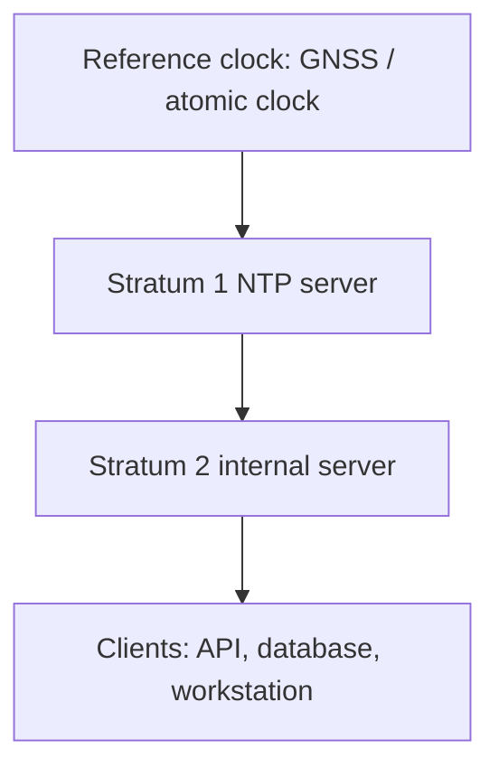
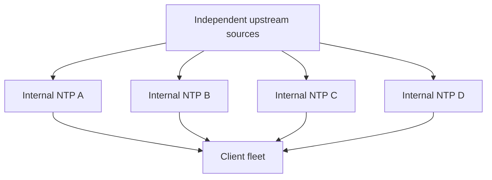

# NTP Server: What It Is, Why It Matters, and Where It Is Used

## 1. A practical definition

**NTP**, the **Network Time Protocol**, synchronizes computer clocks over a network. An **NTP server** supplies timing information; an **NTP client** measures its relationship to that source and disciplines its operating system clock.

Imagine an online store with separate API, payment, and logging servers. If their clocks differ by minutes, logs can appear to show a payment completing before the order was created. Synchronizing the clocks makes those records more useful during an investigation.

A server can be a software service on an ordinary computer or a dedicated timing appliance. A machine can consume time from upstream sources while serving downstream clients. The protocol is specified in [RFC 5905](https://www.rfc-editor.org/rfc/rfc5905.html).

## 2. Why computers need repeated synchronization

Clock oscillators have frequency error. Temperature, component quality, and operating conditions influence how quickly error accumulates. Setting a clock manually once does not keep it correct indefinitely.

A hypothetical constant error of 20 parts per million produces:

```text
daily_error_seconds = 20 / 1_000_000 * 86_400
daily_error_seconds = 1.728
```

That is about 1.7 seconds per day. It is an arithmetic example, not a universal hardware specification. Periodic synchronization and frequency correction help control drift. See [NTP Clock Quality](https://www.ntp.org/ntpfaq/NTP-s-sw-clocks-quality/).

## 3. System time, UTC, and time zones

| Concept | Meaning | Example |
| --- | --- | --- |
| Hardware clock / RTC | Hardware-maintained time, potentially retained while powered off | Battery-backed motherboard clock |
| System wall clock | Calendar time supplied by the operating system | Order creation timestamp |
| UTC | A shared reference for expressing time | A UTC event timestamp |
| Time zone | Rules for displaying local civil time | `Europe/Berlin` |
| Monotonic clock | A duration clock that does not jump backward when calendar time is set | Measuring request latency |

NTP does not configure a time zone. Two synchronized machines can display different local times for the same instant. If an apparent difference is exactly a few hours, inspect time zone, daylight saving, and application formatting first. See [NTP: Time, what Time?](https://www.ntp.org/ntpfaq/NTP-s-time/).

Represent event instants using UTC or offset-aware timestamps and convert for display. Future civil schedules such as “09:00 every day in Berlin” also require the time zone and calendar rules; a fixed UTC offset alone is insufficient.

## 4. How an exchange estimates time

Typical clients send requests to UDP destination port 123. Network transit time means they cannot simply copy the timestamp in a reply. Four timestamps are involved:

```text
Client                                      Server
T1: request sent --------------------------> T2: request received
T4: response received <--------------------- T3: response sent

offset = ((T2 - T1) + (T3 - T4)) / 2
delay  = (T4 - T1) - (T3 - T2)
```

A positive offset here means that the server is ahead of the client. Consider this illustrative exchange, in milliseconds relative to a shared hypothetical epoch:

```text
T1 = 1000
T2 = 1060
T3 = 1070
T4 = 1030

offset = 50 ms
delay  = 20 ms
```

The client estimates that the server is 50 milliseconds ahead and that the network round trip, excluding server processing, took 20 milliseconds. Unequal outbound and return delays introduce estimation error. Implementations use repeated measurements, filtering, and source assessment rather than trusting one exchange. See [RFC 5905, Section 8](https://www.rfc-editor.org/rfc/rfc5905.html#section-8).

## 5. The stratum hierarchy



Stratum 0 conventionally describes a hardware reference, not an ordinary public network server. A stratum 1 server connects directly to a reference; downstream synchronized levels range through stratum 15. Stratum 16 indicates an unsynchronized condition.

Stratum describes logical distance from the reference. It is neither proof of authenticity nor a guarantee that a lower-stratum server produces a better result at your client. Path conditions matter. See [NTP algorithm FAQ](https://www.ntp.org/ntpfaq/NTP-s-algo/) and [RFC 5905, Section 7.3](https://www.rfc-editor.org/rfc/rfc5905.html#section-7.3).

## 6. Slewing versus stepping

**Slewing** gradually corrects an error by adjusting the clock rate. **Stepping** changes calendar time immediately. A step can correct a large startup error quickly, but a backward jump during operation can confuse code that assumes wall-clock timestamps always increase.

The implementation and configuration determine the policy. Plan large corrections before sensitive applications start. Use the platform's appropriate monotonic clock for local elapsed-time measurements, timeouts, and benchmarks; also check its suspend behavior against your requirements. See [NTP clock discipline concepts](https://www.ntp.org/ntpfaq/NTP-s-algo/).

## 7. Applications and deployment environments

These engineering scenarios illustrate why synchronized time helps. Exact failure behavior and required accuracy depend on the product.

| Environment | Why shared time matters | Possible symptom of an incorrect clock |
| --- | --- | --- |
| Web APIs | Consistent validity checks | A token works on one node but fails on another |
| Logs and distributed tracing | Comparing records across services | A response appears earlier than its request |
| Monitoring | Aligning metric samples | Future-dated samples or confusing graphs |
| TLS and certificates | Evaluating validity intervals | A valid certificate appears expired or not yet valid |
| JWT and authentication | Evaluating `exp`, `nbf`, and time policies | Incorrect acceptance or rejection of credentials |
| Time-based one-time passwords | Aligning generation and validation windows | Correct TOTP codes are rejected |
| Databases and data pipelines | Interpreting timestamps and time-based retention | Misleading reports or inconsistent apparent ages |
| Scheduled jobs | Evaluating calendar schedules | Unexpected behavior after a clock jump |
| Enterprise identity | Consistent authentication infrastructure | Login problems or misleading audit records |
| Routers and firewalls | Correlating network changes | Unclear outage timelines |
| Cameras and access control | Matching footage to physical events | Searching the wrong video interval |
| IoT | Comparing sensor observations | Misaligned measurements |
| Cloud and data centers | Maintaining usable host and VM clocks | Time differences across infrastructure |
| Industry and telecommunications | Supplying time where NTP meets the error budget | Insufficient accuracy in subsystems requiring PTP |

Synchronized time does not establish a total event order or guarantee distributed consistency. Use trace IDs for request paths, domain sequence numbers or versions for business order, and logical clocks where causal relationships require them.

For example, an order ID plus state version is a better basis for reconstructing order transitions than timestamp sorting alone. NTP does not replace transactions, idempotency, or concurrency control.

## 8. Accuracy and operational terminology

| Term | Practical meaning |
| --- | --- |
| Offset | Estimated difference between clocks; check the tool's sign convention |
| Delay | Measured round-trip delay |
| Jitter | Variation in timing measurements |
| Drift / frequency error | Rate at which clock error accumulates |
| Root dispersion | Estimated uncertainty associated with the reference chain, not the current offset |
| Accuracy | Closeness to reference time, not the number of displayed decimal places |
| Holdover | Continued operation using previous estimates after losing the reference |

Millisecond-scale accuracy is common over the Internet; suitable local networks can do better. Hardware timestamping, scheduling, network asymmetry, and reference quality influence the result. Establish an accuracy target and measure it in the actual environment. See [Red Hat's NTP/PTP analysis](https://www.redhat.com/en/blog/combining-ptp-ntp-get-best-both-worlds) and [NTP Clock Quality](https://www.ntp.org/ntpfaq/NTP-s-sw-clocks-quality/).

## 9. Public sources and internal servers

Small deployments can use approved organizational or public sources under their usage terms. Larger deployments often use internal servers to simplify access control and monitoring.



This is an architectural example, not a mandatory server count for every deployment. Separate failure domains and understand client limitations. Four DNS names for one machine are not four independent sources.

For accurate time, IETF guidance recommends at least four independent, diverse sources. One offers no comparison; two disagreeing sources cannot identify the correct one by agreement alone. Monitor them and keep leap-second policies consistent. See [RFC 8633, Section 3](https://www.rfc-editor.org/rfc/rfc8633.html#section-3).

## 10. Networks without Internet access

An isolated network can still use NTP. If UTC accuracy matters, provide a suitable local reference, such as a monitored GNSS timing appliance with usable signal reception. Specify oscillator quality and required holdover duration.

If only internal agreement matters, a local clock can be the designated reference. All machines may then agree while being wrong relative to UTC. Report internal agreement separately from valid UTC reference status. A local-reference mode does not prove UTC correctness. See [chrony FAQ](https://chrony-project.org/faq.html).

## 11. NTP, SNTP, and PTP

| Technology | Typical purpose | Selection consideration |
| --- | --- | --- |
| NTP | General Internet and enterprise synchronization | Appropriate for most ordinary server fleets |
| SNTP | Simpler time synchronization implementations | Source selection and clock control may be more limited |
| PTP | High accuracy on a managed network | Evaluate hardware timestamping, NICs, switches, and the complete timing path |

PTP is a different protocol with different infrastructure considerations. Some industrial, telecommunications, or specialized measurement systems require it. Choose from the application's timing error budget. See [Red Hat: Combining PTP with NTP](https://www.redhat.com/en/blog/combining-ptp-ntp-get-best-both-worlds) and [RFC 5905 introduction](https://www.rfc-editor.org/rfc/rfc5905.html#section-1) for SNTP context.

## 12. Security and NTS

An unauthenticated reply does not prove the sender's identity. A malicious or faulty source can provide incorrect time, and an improperly exposed server can contribute to reflection/amplification attacks. Restrict internal UDP/123 access, keep management interfaces private, update software, and monitor anomalies. See [RFC 8633](https://www.rfc-editor.org/rfc/rfc8633.html).

**Network Time Security (NTS)** adds cryptographic protection. Initial key establishment uses TLS, normally on TCP port 4460; subsequent timing exchanges use NTP over UDP. This does not turn the entire exchange into HTTPS or conceal every timestamp.

Both endpoints need support. Certificate validation and network access must work. Authentication does not prove that the server's own clock is correct or eliminate delay attacks. Do not assume every Windows client or public NTP service supports NTS. See [RFC 8915](https://datatracker.ietf.org/doc/html/rfc8915).

## 13. Windows inspection and configuration

Windows uses **Windows Time / W32Time**. Run these bounded commands in Command Prompt, with Administrator privileges when required:

```bat
cmd /c w32tm /query /status
cmd /c w32tm /query /source
cmd /c w32tm /query /peers
cmd /c w32tm /query /configuration
```

Inspect the selected source, last successful synchronization, and stratum. To collect five offset samples without changing the clock, replace this placeholder with an approved server:

```bat
cmd /c w32tm /stripchart /computer:ntp1.example.net /samples:5 /dataonly
```

A successful strip chart does not establish that the W32Time service is synchronized: their UDP source-port behavior can differ. Ping or a TCP/123 connection test is not sufficient for UDP NTP. See [Microsoft's W32Time tools reference](https://learn.microsoft.com/en-us/windows-server/networking/windows-time-service/windows-time-service-tools-and-settings).

For a **standalone test machine**, the following changes configuration and requests synchronization. Replace all placeholder names first:

```bat
cmd /c w32tm /config /manualpeerlist:"ntp1.example.net,0x8 ntp2.example.net,0x8 ntp3.example.net,0x8 ntp4.example.net,0x8" /syncfromflags:manual /update
cmd /c w32tm /resync /rediscover
cmd /c w32tm /query /status
```

The `0x8` flag selects client mode. Domain members normally follow the AD time hierarchy and Group Policy. The forest-root PDC emulator commonly anchors external synchronization; manually configuring every member can conflict with policy. See [How Windows Time works](https://learn.microsoft.com/en-us/windows-server/networking/windows-time-service/how-the-windows-time-service-works).

## 14. Linux configuration with chrony

Run Linux examples inside Linux. `chronyd` manages synchronization; `chronyc` inspects it. Configuration paths and service names vary: Ubuntu/Debian commonly use `/etc/chrony/chrony.conf`, while RHEL-family systems commonly use `/etc/chrony.conf`.

Adapt the existing configuration rather than replacing the distribution's entire file:

```conf
# Replace these names with approved, independent NTP sources.
server ntp1.example.net iburst
server ntp2.example.net iburst
server ntp3.example.net iburst
server ntp4.example.net iburst

# Permit a large correction only during the first three clock updates.
makestep 1.0 3
```

`iburst` accelerates initial synchronization. `makestep 1.0 3` permits a step for an error exceeding one second during the first three clock updates, not the first three seconds. Restarting the daemon starts that allowance again. See [chrony.conf](https://chrony-project.org/doc/4.6/chrony.conf.html).

To serve an intended internal subnet, add this only on the server and align the UDP/123 firewall policy:

```conf
# Serve only the intended internal subnet.
allow 192.168.10.0/24
```

Preserve distribution-specific drift-file paths, includes, and security settings. Configure downstream clients to use internal sources. See [chrony FAQ: making an NTP server](https://chrony-project.org/faq.html#_how_do_i_make_an_ntp_server).

If an approved source actually supports NTS, its source definition can instead be:

```conf
server nts1.example.net iburst nts
```

Adding `nts` does not give an ordinary server NTS support. Apply changes through the distribution's service-management procedure, then inspect synchronization again. These configuration examples use [chrony's documented directives](https://chrony-project.org/doc/4.6/chrony.conf.html).

## 15. Reading chrony status

Use explicit, noninteractive commands:

```bash
chronyc tracking
chronyc sources -v
chronyc sourcestats -v
```

In `sources`, `*` marks the selected source, `+` marks another source combined with it, `?` can indicate unreachability, an unsynchronized source, or insufficient samples, and `x` indicates a falseticker assessment. `Reach` is octal: `377` means valid replies for the last eight transmissions, not a quality percentage.

Also inspect reference freshness, leap status, offset, and uncertainty in `tracking`. Do not assume a tool uses the same offset sign as the teaching formula above. See [chronyc manual](https://chrony-project.org/doc/4.6/chronyc.html).

## 16. VMs, Docker, and Kubernetes

Ordinary Linux containers see their host kernel's wall clock. In Docker Desktop, that host is normally the Linux VM behind Docker. Running a separate clock-setting daemon in every application container is therefore not the default solution. Assign responsibility at host or VM level and avoid giving application containers clock-setting privileges.

Coordinate guest synchronization with hypervisor features according to platform guidance; do not blindly disable every virtualization time feature. Test pause, resume, and migration. See [chrony FAQ](https://chrony-project.org/faq.html) for virtualized-clock issues.

For Kubernetes, monitor node clocks and their sources. A normal Pod does not independently repair an incorrect node wall clock; this follows from the shared-clock model of ordinary Linux containers.

## 17. Leap seconds and leap smear

Leap seconds adjust the relationship between UTC and Earth-rotation time. Some providers spread the adjustment across an interval, called **leap smear**.

Do not mix smeared and unsmeared sources without a compatible policy: they can intentionally disagree during the adjustment window. Record the provider policy. This describes the mechanism, not the date of any future leap second. See [RFC 8633, Section 3.7](https://www.rfc-editor.org/rfc/rfc8633.html#section-3.7).

## 18. Troubleshooting sequence

1. Classify the symptom: hours of display difference, seconds of actual clock error, or one application's formatting?
2. Read the selected source rather than trusting the configured source list.
3. Check the service and identify competing clock-control mechanisms.
4. Check DNS, UDP/123, return traffic, and NAT. For NTS, include TCP/4460 and certificate validation.
5. Inspect sample freshness and allow initial measurements to accumulate.
6. Compare sources and investigate disagreement rather than repeatedly setting the clock by hand.
7. Inspect load, congestion, suspension, and reference health.
8. Measure again after fixing the cause and verify application behavior too.

See [chrony synchronization troubleshooting](https://chrony-project.org/faq.html#_computer_is_not_synchronising) and [W32Time tools](https://learn.microsoft.com/en-us/windows-server/networking/windows-time-service/windows-time-service-tools-and-settings).

## 19. Operational checklist

- [ ] Define tolerable UTC error, inter-node error, and reference-outage duration.
- [ ] Assign clock-control responsibility for each host or VM.
- [ ] Use approved independent sources with compatible leap policies.
- [ ] Monitor synchronization state and last successful updates.
- [ ] Alert on sustained offset, uncertainty, and lost sources.
- [ ] Restrict service and management access.
- [ ] Test startup, disconnection, and reference recovery.
- [ ] Coordinate stepping with sensitive applications.
- [ ] Use suitable duration clocks and explicit business ordering.

A sustained 100-millisecond threshold can be a teaching example, not a universal standard. Systems tolerating two seconds and systems requiring 100 microseconds need different operational policies.

## 20. Questions and exercises

**Does NTP increase Internet speed?** No. It synchronizes clocks and may resolve time-related application errors.

**Can it work offline?** Yes, within a network. UTC correctness still depends on a reference and holdover quality.

**Is it a time-zone setting?** No. Clock synchronization and local display rules are separate.

**Is stratum 1 always better than stratum 2?** No. Source health and network conditions matter.

**Does NTP guarantee transaction order?** No. The application still needs appropriate ordering and consistency mechanisms.

**Exercise 1:** Two machines display times two hours apart but report the same UTC instant. What should you inspect? **Answer:** Time zones, daylight saving, and display conversion; the symptom alone does not show NTP failure.

**Exercise 2:** A token issuer is five minutes ahead. A correctly timed verifier checks `nbf`. What can happen? **Answer:** The token may appear not yet valid. Fix the clock rather than adding unlimited clock-skew tolerance.

**Exercise 3:** Four source names lead to one machine and one GNSS receiver. Are they independent? **Answer:** No. They share important failure modes.

**Exercise 4:** A locally measured request duration is negative. What should you inspect first? **Answer:** Look for subtraction of wall-clock timestamps and clock steps; use an appropriate monotonic clock for local duration measurement. If timestamps came from different machines, also investigate clock differences.

## 21. Further reading

- [RFC 5905](https://www.rfc-editor.org/rfc/rfc5905.html): protocol and algorithms.
- [RFC 8633](https://www.rfc-editor.org/rfc/rfc8633.html): operational best practices.
- [RFC 8915](https://datatracker.ietf.org/doc/html/rfc8915): NTS security.
- [NTP FAQ](https://www.ntp.org/ntpfaq/NTP-s-algo/): hierarchy and clock discipline.
- [chrony configuration](https://chrony-project.org/doc/4.6/chrony.conf.html) and [chronyc](https://chrony-project.org/doc/4.6/chronyc.html): version 4.6 reference used by these examples; check installed-version compatibility.
- [Microsoft Windows Time](https://learn.microsoft.com/en-us/windows-server/networking/windows-time-service/windows-time-service-tools-and-settings): Windows commands and configuration.
- [NTP Pool usage](https://www.ntppool.org/en/use.html): public pool usage guidance. The `example.net` names in this chapter are placeholders, not real time servers to copy unchanged.
