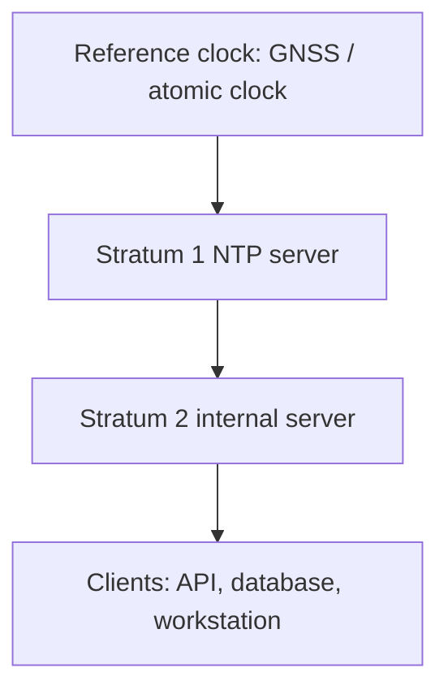
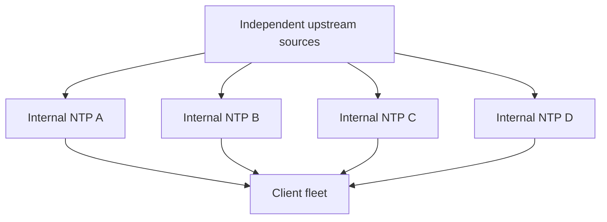

<div dir="rtl">

# سرور NTP چیست و کجا استفاده می‌شود؟

## ۱. تعریف ساده با یک مثال

**NTP** مخفف **Network Time Protocol**، یعنی «پروتکل زمان شبکه» است. این پروتکل به دستگاه‌ها کمک می‌کند ساعت سیستم‌عامل خود را با منابع زمانی مرجع هماهنگ نگه دارند. **NTP Server** سرویسی است که از طریق شبکه اطلاعات زمانی می‌دهد؛ **NTP Client** آن اطلاعات را دریافت می‌کند و برای تنظیم ساعت خود به کار می‌گیرد.

فرض کنید در یک فروشگاه اینترنتی سه دستگاه داریم: سرور API، سرور پرداخت و سرور ثبت لاگ. اگر ساعت اولی دو دقیقه جلو و ساعت دومی یک دقیقه عقب باشد، ممکن است از روی لاگ‌ها چنین برداشت کنیم که پرداخت پیش از ساخته‌شدن سفارش انجام شده است. هماهنگ‌بودن ساعت‌ها بررسی رخدادها را قابل‌اعتمادتر می‌کند.

سرور NTP لزوماً دستگاه جداگانه و گران‌قیمتی نیست. یک سرویس نرم‌افزاری روی Linux یا Windows هم می‌تواند این نقش را داشته باشد؛ در محیط‌های تخصصی از تجهیزات زمان‌سنجی اختصاصی استفاده می‌شود. یک دستگاه می‌تواند زمان را از بالادست بگیرد و هم‌زمان به دستگاه‌های پایین‌دست ارائه کند. مبنای پروتکل در [RFC 5905](https://www.rfc-editor.org/rfc/rfc5905.html) آمده است.

## ۲. چرا ساعت دستگاه‌ها خودبه‌خود دقیق نمی‌ماند؟

ساعت سخت‌افزاری و زمان‌سنج‌های سیستم به نوسان‌سازهایی وابسته‌اند که خطای فرکانسی دارند. دما، کیفیت قطعات و شرایط کار روی این خطا اثر می‌گذارند. تنظیم دستی امروز تضمین نمی‌کند ساعت فردا هم درست بماند.

برای مثال، خطای ثابت فرضی **۲۰ ppm** یعنی به‌ازای هر یک میلیون ثانیه، ۲۰ ثانیه اختلاف جمع می‌شود:

```text
daily_error_seconds = 20 / 1_000_000 * 86_400
daily_error_seconds = 1.728
```

پس حتی خطای کوچک می‌تواند روزانه حدود ۱٫۷ ثانیه اختلاف بسازد. این عدد مثال محاسباتی است، نه مقدار ثابت خطای همهٔ دستگاه‌ها. NTP با اندازه‌گیری دوره‌ای و اصلاح ساعت، با چنین انحرافی مقابله می‌کند. توضیح کیفیت ساعت در [راهنمای NTP دربارهٔ Clock Quality](https://www.ntp.org/ntpfaq/NTP-s-sw-clocks-quality/) آمده است.

## ۳. ساعت سیستم، UTC و منطقهٔ زمانی

| مفهوم | معنی | نمونه |
| --- | --- | --- |
| ساعت سخت‌افزاری یا RTC | ساعت نگه‌داشته‌شده توسط سخت‌افزار؛ ممکن است هنگام خاموشی هم کار کند | ساعت دارای باتری مادربرد |
| ساعت سیستم یا Wall Clock | زمان تقویمی که سیستم‌عامل به برنامه می‌دهد | زمان ثبت سفارش |
| UTC | مرجع مشترک برای بیان زمان | timestamp یک رخداد در قالب UTC |
| Time Zone | قواعد تبدیل زمان به نمایش محلی | `Europe/Berlin` |
| Monotonic Clock | زمان‌سنج مناسب اندازه‌گیری فاصلهٔ زمانی که با تنظیم ساعت تقویمی عقب نمی‌رود | محاسبهٔ مدت اجرای درخواست |

**NTP منطقهٔ زمانی را تعیین نمی‌کند.** دو دستگاه با ساعت هماهنگ می‌توانند یک لحظه را با ساعت محلی متفاوت نمایش دهند. اگر اختلاف دقیقاً چند ساعت است، پیش از دست‌کاری NTP، تنظیمات منطقهٔ زمانی و قواعد ساعت تابستانی را بررسی کنید. مفهوم UTC در [راهنمای زمان NTP](https://www.ntp.org/ntpfaq/NTP-s-time/) توضیح داده شده است.

در طراحی نرم‌افزار، لحظهٔ رخداد را معمولاً به‌شکل UTC یا timestamp دارای offset ثبت کنید و تبدیل محلی را هنگام نمایش انجام دهید. برای قرارهای آینده مثل «هر روز ساعت ۹ برلین»، منطقهٔ زمانی و قواعد تقویمی نیز بخشی از دادهٔ کسب‌وکارند؛ نگهداری یک offset ثابت کافی نیست.

## ۴. NTP چگونه کار می‌کند؟

در حالت رایج، کلاینت درخواست می‌فرستد و سرور پاسخ می‌دهد. NTP معمولاً از **UDP و پورت مقصد ۱۲۳** استفاده می‌کند. چون رفت‌وبرگشت بسته زمان می‌برد، کلاینت صرفاً ساعت پاسخ را روی سیستم کپی نمی‌کند.

چهار زمان در یک تبادل در نظر گرفته می‌شود:

```text
Client                                      Server
T1: request sent --------------------------> T2: request received
T4: response received <--------------------- T3: response sent

offset = ((T2 - T1) + (T3 - T4)) / 2
delay  = (T4 - T1) - (T3 - T2)
```

در این فرمول، offset مثبت یعنی ساعت سرور نسبت به کلاینت جلو است. فرض آموزشی زیر را در نظر بگیرید؛ اعداد برحسب میلی‌ثانیه و نسبت به یک مبدأ مشترک فرضی هستند:

```text
T1 = 1000
T2 = 1060
T3 = 1070
T4 = 1030

offset = ((1060 - 1000) + (1070 - 1030)) / 2 = 50 ms
delay  = (1030 - 1000) - (1070 - 1060) = 20 ms
```

نتیجه: سرور حدود ۵۰ میلی‌ثانیه جلو است و زمان رفت‌وبرگشت شبکه، پس از کسر زمان پردازش سرور، حدود ۲۰ میلی‌ثانیه است.

این تخمین به تقریبِ تقارن تأخیر دو مسیر وابسته است؛ مسیر رفت ۲ میلی‌ثانیه‌ای و برگشت ۱۸ میلی‌ثانیه‌ای باعث خطای تخمین می‌شود. پیاده‌سازی‌های NTP با نمونه‌های متعدد، فیلتر و ارزیابی منابع تصمیم می‌گیرند. فرمول‌ها و فرایند تبادل در [RFC 5905، بخش ۸](https://www.rfc-editor.org/rfc/rfc5905.html#section-8) تعریف شده‌اند.

## ۵. Stratum یعنی چه؟

Stratum فاصلهٔ منطقی یک منبع از مرجع زمانی در سلسله‌مراتب NTP را نشان می‌دهد:



- **Stratum 0:** اصطلاح رایج برای مرجع سخت‌افزاری مثل گیرندهٔ زمان GNSS؛ خود این عنوان به معنی یک سرور عمومی شبکه نیست.
- **Stratum 1:** سروری که مستقیماً به مرجع زمانی وصل است.
- **Stratum 2 تا 15:** سطوح بعدی همگام‌سازی.
- **Stratum 16:** نشانهٔ همگام‌نبودن در مدل NTP.

عدد کمتر تضمین‌کنندهٔ ساعت بهتر در محل کلاینت نیست؛ کیفیت مسیر و منبع هم اثر دارد. همچنین Stratum اعلامی گواه اصالت سرور نیست. شرح سلسله‌مراتب در [راهنمای الگوریتم NTP](https://www.ntp.org/ntpfaq/NTP-s-algo/) و مقادیر فیلد در [RFC 5905، بخش ۷٫۳](https://www.rfc-editor.org/rfc/rfc5905.html#section-7.3) آمده است.

## ۶. اصلاح ساعت: Slew و Step

**Slew** یعنی اصلاح تدریجی با تغییر محدود سرعت ساعت؛ **Step** یعنی جابه‌جایی ناگهانی زمان. مثلاً اصلاح یک اختلاف بزرگ هنگام راه‌اندازی با Step می‌تواند سریع‌تر باشد، ولی عقب‌بردن ناگهانی ساعت در حین کار برنامه ممکن است ترتیب timestampها یا محاسبات وابسته به Wall Clock را به هم بزند.

رفتار دقیق به نرم‌افزار و تنظیمات آن بستگی دارد. سیاست اصلاح اختلاف بزرگ را پیش از ورود سرویس‌های حساس به مدار مشخص کنید. برای محاسبهٔ مدت درخواست، timeout و benchmark از زمان‌سنج monotonic مناسب زبان و سیستم‌عامل استفاده کنید؛ رفتار آن هنگام suspend نیز باید با نیاز برنامه سازگار باشد. تفاوت اصلاح تدریجی و ناگهانی در [راهنمای الگوریتم NTP](https://www.ntp.org/ntpfaq/NTP-s-algo/) توضیح داده شده است.

## ۷. کاربردها و محل‌های استفاده

جدول زیر سناریوهای مهندسی برای نشان‌دادن اثر اختلاف ساعت است. میزان حساسیت و راه‌حل دقیق هر محصول را باید از مستندات همان محصول گرفت.

| محیط | کاربرد زمان هماهنگ | نمونهٔ مشکل ساعت نادرست |
| --- | --- | --- |
| وب‌سایت و API | بررسی زمان ساخت و اعتبار داده‌ها | توکن روی یک نود معتبر و روی دیگری منقضی تشخیص داده می‌شود |
| لاگ و Distributed Tracing | مقایسهٔ رخدادها میان سرویس‌ها | رخداد دریافت پاسخ زودتر از ارسال درخواست دیده می‌شود |
| مانیتورینگ | هم‌ترازی نمونه‌های متریک و هشدارها | دادهٔ ظاهراً متعلق به آینده یا نمودار گمراه‌کننده |
| TLS و زیرساخت گواهی | بررسی بازهٔ اعتبار گواهی | گواهی معتبر، هنوز معتبرنشده یا منقضی دیده می‌شود |
| JWT، OAuth و احراز هویت | بررسی زمان‌های `exp`، `nbf` و سیاست‌های زمانی | خطای ورود یا پذیرش نامناسب توکن |
| رمز یک‌بارمصرف زمانی | هماهنگی بازهٔ تولید و بررسی TOTP | ردشدن کد صحیح کاربر |
| دیتابیس و پردازش داده | تفسیر timestampها، TTL و تحلیل رخدادها | دادهٔ زمان‌دار یا گزارش ظاهراً ناسازگار |
| Job و Scheduler | اجرای کارهای تقویمی | رفتار نامطلوب هنگام جهش ساعت؛ وابسته به scheduler |
| شبکهٔ سازمانی | هم‌خوانی ساعت هویت، تجهیزات و لاگ‌ها | دشواری بررسی ورودها یا رخدادهای امنیتی |
| روتر، سوییچ و فایروال | تطبیق رخدادهای شبکه | تشخیص دشوار ترتیب قطع ارتباط و تغییر مسیر |
| دوربین و کنترل دسترسی | تطبیق تصویر با ورود و خروج | جست‌وجوی تصویر در بازهٔ اشتباه |
| دستگاه‌های IoT | زمان‌گذاری نمونه‌های حسگر | مقایسهٔ اشتباه اندازه‌گیری چند حسگر |
| دیتاسنتر و Cloud | مرجع زمانی قابل پایش برای میزبان‌ها | اختلاف ساعت میان VMها و سرویس‌ها |
| صنعت و مخابرات | تأمین زمان برای بخش‌های دارای نیاز متناسب | ناکافی‌بودن دقت برای بخش‌هایی که به PTP نیاز دارند |

**NTP جایگزین تضمین ترتیب رخدادها نیست.** حتی با ساعت سالم، دو رخداد بسیار نزدیک ممکن است timestampهای گمراه‌کننده داشته باشند. برای مسیر درخواست از correlation ID و trace ID، برای ترتیب دامنه از sequence یا نسخه، و برای رابطهٔ علت‌ومعلولی در طراحی مناسب از ساعت منطقی استفاده کنید.

مثلاً در سناریوی سفارش، ذخیرهٔ `order_id` و نسخهٔ تغییر وضعیت، از نتیجه‌گیری صرف بر اساس ساعت مطمئن‌تر است. NTP کیفیت زمان را بهتر می‌کند؛ اتمیک‌بودن تراکنش، سازگاری توزیع‌شده و جلوگیری از پردازش تکراری همچنان مسئولیت طراحی سامانه‌اند.

## ۸. دقت واقعی و اصطلاحات پایش

| اصطلاح | برداشت عملی |
| --- | --- |
| Offset | اختلاف تخمینی دو ساعت؛ قرارداد علامت هر ابزار را بررسی کنید |
| Delay | تأخیر رفت‌وبرگشت اندازه‌گیری‌شده |
| Jitter | نوسان اندازه‌گیری‌های زمانی |
| Drift / Frequency error | نرخ جلو یا عقب افتادن ساعت |
| Root dispersion | برآورد رشد عدم‌قطعیت در ارتباط با مرجع؛ معادل offset نیست |
| Accuracy | نزدیکی به زمان مرجع؛ تعداد رقم خروجی آن را تضمین نمی‌کند |
| Holdover | ادامهٔ کار با برآورد قبلی پس از ازدست‌رفتن مرجع، همراه با افزایش عدم‌قطعیت |

در اینترنت معمولی، دقت در حد میلی‌ثانیه رایج است؛ در LAN مناسب امکان دقت بهتر وجود دارد. کیفیت timestamp سخت‌افزاری، مسیر شبکه، بار میزبان و مرجع تعیین‌کننده‌اند. عدد تضمینی را با اندازه‌گیری همان محیط به دست آورید، نه با نام پروتکل. تفاوت دقت NTP و PTP در [تحلیل فنی Red Hat](https://www.redhat.com/en/blog/combining-ptp-ntp-get-best-both-worlds) و مفاهیم کیفیت ساعت در [NTP Clock Quality](https://www.ntp.org/ntpfaq/NTP-s-sw-clocks-quality/) تشریح شده‌اند.

## ۹. سرور عمومی یا داخلی؟

**محیط کوچک:** دستگاه‌ها می‌توانند از سرویس زمانی مجاز سازمان یا منابع عمومی مطابق شرایط ارائه‌دهنده استفاده کنند. **سازمان بزرگ:** سرورهای داخلی مدیریت فایروال، پایش و دسترسی کلاینت‌ها را ساده‌تر می‌کنند.



این دیاگرام نمونهٔ معماری است، نه الزام تعداد سرور برای همهٔ سازمان‌ها. منابع و سرورهای داخلی را در نقاط خرابی متفاوت قرار دهید؛ چهار نام DNS روی یک میزبان تنوع واقعی ایجاد نمی‌کند. محدودیت‌های کلاینت، به‌ویژه Windows Domain، در انتخاب معماری اثر دارند.

برای سامانه‌های نیازمند زمان دقیق، راهنمای IETF دست‌کم چهار منبع مستقل و متنوع را توصیه می‌کند. یک منبع، امکان مقایسه نمی‌دهد؛ دو منبع مخالف هم به‌تنهایی مشخص نمی‌کنند کدام درست است. پایش و سیاست مشترک leap second نیز ضروری است. جزئیات در [RFC 8633، بخش ۳](https://www.rfc-editor.org/rfc/rfc8633.html#section-3) آمده است.

## ۱۰. شبکهٔ بدون اینترنت

در شبکهٔ بسته هم می‌توان NTP داشت:

1. اگر زمان نزدیک به UTC لازم است، مرجع محلی مناسب مانند تجهیز GNSS دارای امکان دریافت سیگنال و کنترل سلامت فراهم کنید.
2. برای تاب‌آوری، کیفیت نوسان‌ساز و مدت holdover موردنیاز را مشخص کنید.
3. اگر فقط هماهنگی داخلی لازم است، می‌توان یک ساعت محلی را مرجع قراردادی قرار داد؛ همهٔ دستگاه‌ها ممکن است هماهنگ ولی نسبت به UTC نادرست باشند.
4. وضعیت «هماهنگی داخلی» را از «اتصال به مرجع UTC» در پایش جدا گزارش کنید.

فعال‌کردن حالت مرجع محلی بدون مرجع معتبر نباید به‌عنوان اثبات صحت UTC تعبیر شود. نمونهٔ شبکهٔ جداافتاده و ملاحظات سرویس‌دهی داخلی در [پرسش‌های متداول chrony](https://chrony-project.org/faq.html) آمده است.

## ۱۱. مقایسهٔ NTP، SNTP و PTP

| فناوری | هدف متداول | نکتهٔ انتخاب |
| --- | --- | --- |
| NTP | همگام‌سازی عمومی در اینترنت و شبکهٔ سازمان | مناسب اغلب سرورها و ایستگاه‌های کاری |
| SNTP | پیاده‌سازی ساده‌تر تبادل زمان | قابلیت انتخاب منابع و کنترل ساعت می‌تواند محدودتر باشد |
| PTP | دقت بالا در شبکهٔ مدیریت‌شده | معمولاً نیازمند ارزیابی NIC، timestamp سخت‌افزاری و تجهیزات شبکه |

PTP با «سریع‌ترکردن NTP» یکسان نیست؛ معماری و الزامات متفاوتی دارد. خطوط صنعتی حساس، برخی شبکه‌های مخابراتی و اندازه‌گیری‌های تخصصی ممکن است به آن نیاز داشته باشند. انتخاب باید از بودجهٔ خطای زمانی شروع شود. برای مقایسه به [Red Hat: Combining PTP with NTP](https://www.redhat.com/en/blog/combining-ptp-ntp-get-best-both-worlds) و برای SNTP به [RFC 5905، مقدمه](https://www.rfc-editor.org/rfc/rfc5905.html#section-1) مراجعه کنید.

## ۱۲. امنیت و NTS

در NTP عادیِ بدون احراز اصالت، دریافت پاسخ به معنی قابل‌اعتمادبودن فرستنده نیست. مهاجم یا منبع خراب می‌تواند زمان نادرست بدهد. سرور عمومیِ بدپیکربندی‌شده نیز می‌تواند در حملات reflection/amplification مورد سوءاستفاده قرار گیرد.

برای سرور داخلی، دسترسی UDP/123 را به شبکه‌های مجاز محدود کنید، قابلیت‌های مدیریتی را عمومی نکنید، نرم‌افزار را به‌روز نگه دارید و تغییرات غیرعادی منبع یا ساعت را پایش کنید. مرجع عملیاتی این نکات [RFC 8633](https://www.rfc-editor.org/rfc/rfc8633.html) است.

**NTS یا Network Time Security** برای محافظت رمزنگاری‌شده از تبادل NTP طراحی شده است. برقراری اولیهٔ کلید با TLS و معمولاً روی **TCP/4460** انجام می‌شود؛ بسته‌های زمان همچنان از NTP روی UDP استفاده می‌کنند. فعال‌بودن TLS به معنی انتقال تمام timestampهای NTP داخل HTTPS یا مخفی‌شدن همهٔ داده‌های زمانی نیست.

NTS به پشتیبانی دو طرف، اعتبارسنجی گواهی و شبکهٔ مناسب نیاز دارد؛ تمام سرورهای NTP یا کلاینت‌های Windows الزاماً از آن پشتیبانی نمی‌کنند. احراز اصالت، صحت ساعت خود سرور یا نبود حملهٔ تأخیر را تضمین نمی‌کند. مشخصات در [RFC 8915](https://datatracker.ietf.org/doc/html/rfc8915) آمده است.

## ۱۳. بررسی NTP در Windows

Windows از سرویس **Windows Time / W32Time** استفاده می‌کند. دستورهای زیر را در Command Prompt، در صورت نیاز با دسترسی Administrator، اجرا کنید:

```bat
cmd /c w32tm /query /status
cmd /c w32tm /query /source
cmd /c w32tm /query /peers
cmd /c w32tm /query /configuration
```

به نام منبع، آخرین همگام‌سازی موفق و Stratum توجه کنید. برای پنج نمونهٔ اختلاف با یک سرور مجاز، نام فرضی زیر را جایگزین کنید:

```bat
cmd /c w32tm /stripchart /computer:ntp1.example.net /samples:5 /dataonly
```

این فرمان ساعت را تغییر نمی‌دهد. موفقیت `stripchart` به‌تنهایی اثبات نمی‌کند سرویس W32Time هم درست همگام می‌شود؛ این دو می‌توانند از پورت مبدأ UDP متفاوت استفاده کنند. `ping` یا آزمایش TCP/123 نیز آزمون کافی برای NTP روی UDP نیست. مرجع دستورها [Microsoft: Windows Time tools and settings](https://learn.microsoft.com/en-us/windows-server/networking/windows-time-service/windows-time-service-tools-and-settings) است.

### دستگاه مستقل در برابر عضو Domain

برای یک **دستگاه مستقل آزمایشی**، پس از جایگزینی نام‌ها با سرورهای واقعی و مجاز، نمونهٔ زیر فهرست منابع دستی را تنظیم و همگام‌سازی درخواست می‌کند؛ برخلاف فرمان‌های قبلی، تنظیمات را تغییر می‌دهد:

```bat
cmd /c w32tm /config /manualpeerlist:"ntp1.example.net,0x8 ntp2.example.net,0x8 ntp3.example.net,0x8 ntp4.example.net,0x8" /syncfromflags:manual /update
cmd /c w32tm /resync /rediscover
cmd /c w32tm /query /status
```

گزینهٔ `0x8` حالت client را مشخص می‌کند. در عضو Domain معمولاً سلسله‌مراتب AD و Group Policy تعیین‌کننده‌اند؛ نقطهٔ مرجع بیرونی معمولاً PDC Emulator در ریشهٔ forest است. تنظیم دستی تک‌تک اعضا ممکن است با این سیاست ناسازگار باشد. معماری در [Microsoft: How Windows Time works](https://learn.microsoft.com/en-us/windows-server/networking/windows-time-service/how-the-windows-time-service-works) توضیح داده شده است.

## ۱۴. نمونهٔ Linux با chrony

این قسمت داخل Linux اجرا می‌شود؛ اجرای آن برای خواندن راهنما ضروری نیست. در chrony، سرویس `chronyd` ساعت را مدیریت می‌کند و ابزار `chronyc` وضعیت آن را نشان می‌دهد. مسیر فایل و نام سرویس به توزیع وابسته است؛ در Ubuntu/Debian معمولاً `/etc/chrony/chrony.conf` و در خانوادهٔ RHEL معمولاً `/etc/chrony.conf` است.

نمونهٔ زیر را با تنظیمات موجود تطبیق دهید و منابع را جایگزین کنید؛ فایل توزیع را کورکورانه بازنویسی نکنید:

```conf
# Replace these names with approved, independent NTP sources.
server ntp1.example.net iburst
server ntp2.example.net iburst
server ntp3.example.net iburst
server ntp4.example.net iburst

# Permit a large correction only during the first three clock updates.
makestep 1.0 3
```

`iburst` همگام‌سازی اولیه را سریع‌تر می‌کند. `makestep 1.0 3` اجازهٔ جهش برای اختلاف بیش از یک ثانیه در سه به‌روزرسانی نخست ساعت را می‌دهد؛ **سه ثانیه** معنی نمی‌دهد و پس از restart سرویس این بازه دوباره آغاز می‌شود. مرجع گزینه‌ها [chrony.conf](https://chrony-project.org/doc/4.6/chrony.conf.html) است.

برای سرویس‌دهی به شبکهٔ داخلی فرضی، خط زیر را فقط روی سرور اضافه کنید و دسترسی فایروال UDP/123 را برای همان شبکه تطبیق دهید:

```conf
# Serve only the intended internal subnet.
allow 192.168.10.0/24
```

کلاینت‌های داخلی منابع خود را روی سرورهای داخلی تنظیم می‌کنند. مسیرهای `driftfile`، فایل‌های include و تنظیمات امنیتی بستهٔ توزیع را حفظ کنید. راهنمای تبدیل کلاینت به سرور در [chrony FAQ، بخش ۲٫۲](https://chrony-project.org/faq.html#_how_do_i_make_an_ntp_server) آمده است.

اگر سرور مجاز واقعاً NTS را پشتیبانی می‌کند، شکل تعریف آن می‌تواند چنین باشد؛ این خط جایگزین تعریف همان منبع است:

```conf
server nts1.example.net iburst nts
```

افزودن `nts` به نام یک سرور معمولی، آن را به سرور NTS تبدیل نمی‌کند. تغییرات را با روش مدیریت سرویس همان توزیع اعمال کنید و سپس وضعیت را دوباره بخوانید.

## ۱۵. خواندن وضعیت chrony

فرمان‌های محدود و غیرتعاملی برای Linux:

```bash
chronyc tracking
chronyc sources -v
chronyc sourcestats -v
```

در `sources`، علامت `*` منبع منتخب و `+` منبع ترکیب‌شده با آن را نشان می‌دهد. `?` می‌تواند از دسترسی‌نداشتن، همگام‌نبودن یا کمبود نمونه باشد. `x` اختلاف با منابع قابل‌اعتمادتر را نشان می‌دهد. مقدار `Reach` به‌شکل هشت‌هشتی است؛ `377` یعنی هر هشت تبادل اخیر پاسخ معتبر داشته‌اند، نه ۳۷۷ درصد کیفیت.

صرف وجود `*` کافی نیست؛ در `tracking`، تازگی مرجع، وضعیت leap، offset و عدم‌قطعیت را هم بررسی کنید. قرارداد علامت گزارش ابزار را با فرمول آموزشی بخش ۴ یکی فرض نکنید. جزئیات در [chronyc manual](https://chrony-project.org/doc/4.6/chronyc.html) آمده است.

## ۱۶. VM، Docker و Kubernetes

کانتینرهای عادی Linux ساعت تقویمی کرنل میزبان خود را می‌بینند؛ در Docker Desktop این میزبان معمولاً VM لینوکسی پشت Docker است، نه مستقیماً کرنل Windows. بنابراین نصب یک سرویس تنظیم ساعت در هر کانتینر راه‌حل پیش‌فرض نیست. مسئولیت ساعت را در سطح میزبان یا VM روشن کنید و به کانتینر برنامه مجوز تغییر ساعت ندهید.

در ماشین مجازی، هماهنگی سرویس زمان مهمان با قابلیت‌های hypervisor را طبق راهنمای همان محیط تنظیم کنید. فرض نکنید همهٔ قابلیت‌های زمان مجازی‌سازی باید خاموش شوند. pause، resume و migration را نیز در آزمون عملی بگنجانید. مشکلات محیط مجازی و راه‌های تشخیص در [chrony FAQ](https://chrony-project.org/faq.html) بررسی شده‌اند.

در Kubernetes، ساعت نودها، وضعیت منابع و اختلاف زمانی را زیر نظر بگیرید. اجرای Pod معمولی، ساعت خراب نود را به‌تنهایی درست نمی‌کند. این توصیه، پیامد اشتراک ساعت میزبان در کانتینرهای عادی Linux است.

## ۱۷. Leap Second و Leap Smear

Leap second سازوکاری برای اصلاح رابطهٔ UTC با زمان مبتنی بر چرخش زمین است. بعضی ارائه‌دهندگان به‌جای نمایش جهش، تغییر را در یک بازه پخش می‌کنند که **Leap Smear** نام دارد.

منابع smear و غیرsmear را بدون سیاست سازگار مخلوط نکنید؛ در بازهٔ اصلاح ممکن است عمداً زمان‌های متفاوتی بدهند. نوع رفتار ارائه‌دهنده را در طراحی ثبت کنید. این بخش دربارهٔ سازوکار است و ادعایی دربارهٔ تاریخ رخداد بعدی ندارد. ملاحظات عملی در [RFC 8633، بخش ۳٫۷](https://www.rfc-editor.org/rfc/rfc8633.html#section-3.7) آمده است.

## ۱۸. عیب‌یابی قدم‌به‌قدم

1. **نشانه را دقیق کنید:** اختلاف چند ساعت است، چند ثانیه است یا فقط یک برنامه زمان نادرست نشان می‌دهد؟ زمان محلی را با UTC اشتباه نگیرید.
2. **منبع فعال را بخوانید:** نام ثبت‌شده در فایل با منبع واقعاً انتخاب‌شده یکسان نیست.
3. **سرویس را بررسی کنید:** نصب‌بودن ابزار به معنی فعال‌بودن همگام‌سازی نیست؛ چند سرویس مستقل نیز نباید بدون طراحی ساعت را تنظیم کنند.
4. **DNS و UDP/123 را بررسی کنید:** قوانین فایروال، NAT و مسیر پاسخ مهم‌اند. برای NTS، TCP/4460 و گواهی را هم بررسی کنید.
5. **تازگی و تعداد نمونه‌ها را ببینید:** پس از راه‌اندازی به سرویس فرصت جمع‌آوری داده بدهید.
6. **منابع را مقایسه کنید:** اختلاف شدید را با تنظیم دستی مکرر ساعت پنهان نکنید.
7. **زیرساخت را بررسی کنید:** بار CPU، ازدحام، suspend/resume و مشکلات مرجع می‌توانند دخیل باشند.
8. **پس از اصلاح علت، دوباره اندازه بگیرید:** خروجی وضعیت و اثر روی خطای کاربردی را با هم بررسی کنید.

برای خطاهای عملی chrony به [FAQ عیب‌یابی](https://chrony-project.org/faq.html#_computer_is_not_synchronising) و برای مسیر Windows به [راهنمای ابزارهای W32Time](https://learn.microsoft.com/en-us/windows-server/networking/windows-time-service/windows-time-service-tools-and-settings) مراجعه کنید.

## ۱۹. چک‌لیست بهره‌برداری

- [ ] نیاز زمانی محصول مشخص است: اختلاف قابل‌قبول با UTC و میان نودها، و مدت مجاز قطع مرجع.
- [ ] مسئول تنظیم ساعت در هر میزبان یا VM معلوم است.
- [ ] منابع انتخاب‌شده، مستقل، مجاز و دارای سیاست leap سازگارند.
- [ ] وضعیت همگام‌سازی و زمان آخرین موفقیت پایش می‌شود.
- [ ] برای offset، عدم‌قطعیت و ازدست‌رفتن منابع هشدار متناسب تعریف شده است.
- [ ] دسترسی سرویس داخلی و مدیریت آن محدود است.
- [ ] رفتار هنگام راه‌اندازی، قطع شبکه و بازگشت مرجع آزمایش شده است.
- [ ] تغییرات ساعت با برنامه‌های حساس و سیاست Step هماهنگ است.
- [ ] مدت‌سنجی برنامه از ساعت تقویمی مستقل است و ترتیب کسب‌وکار فقط به timestamp تکیه ندارد.

برای مثال آموزشی می‌توان هشدار اختلاف بیش از ۱۰۰ میلی‌ثانیه برای چند دقیقه را نقطهٔ شروع بحث دانست؛ این عدد استاندارد عمومی نیست. برای محصولی با تحمل دو ثانیه یا محصولی با تحمل صد میکروثانیه، سیاست متفاوتی لازم است.

## ۲۰. پرسش‌های پرتکرار و تمرین

**آیا NTP اینترنت را سریع‌تر می‌کند؟** خیر؛ وظیفهٔ آن همگام‌سازی ساعت است. ممکن است خطاهای ناشی از زمان را رفع کند، ولی ابزار افزایش پهنای باند نیست.

**آیا بدون اینترنت هم کار می‌کند؟** بله؛ شبکهٔ داخلی کافی است، اما صحت نسبت به UTC به مرجع معتبر یا کیفیت holdover وابسته است.

**آیا NTP با تغییر Time Zone یکی است؟** خیر؛ اولی به ساعت و دومی به نمایش محلی و قواعد آن مربوط است.

**آیا هر Stratum 1 از هر Stratum 2 بهتر است؟** خیر؛ مسیر شبکه، کیفیت مرجع و سلامت سرویس هم مهم‌اند.

**آیا ساعت هماهنگ، ترتیب قطعی تراکنش‌ها را تضمین می‌کند؟** خیر؛ ترتیب و سازگاری به سازوکارهای خود سامانه نیاز دارند.

**تمرین ۱:** دو سرور دقیقاً دو ساعت اختلاف نمایش دارند ولی یک timestamp UTC یکسان را گزارش می‌کنند. چه چیزی را بررسی می‌کنید؟ **پاسخ:** منطقهٔ زمانی، DST و تبدیل در لایهٔ نمایش؛ این نشانه به‌تنهایی خرابی NTP نیست.

**تمرین ۲:** ساعت A پنج دقیقه جلو است و توکن کوتاه‌عمر صادر می‌کند. B ساعت درست دارد و `nbf` توکن را بررسی می‌کند. چه خطایی ممکن است رخ دهد؟ **پاسخ:** B ممکن است توکن را هنوز قابل‌استفاده نداند. علت ساعت را اصلاح کنید؛ افزایش بی‌حدِ تحمل اختلاف، راه‌حل مناسب نیست.

**تمرین ۳:** چهار منبع از یک دستگاه و یک گیرندهٔ GNSS مشترک تغذیه می‌شوند. آیا مستقل‌اند؟ **پاسخ:** خیر؛ خرابی مشترک همچنان وجود دارد.

**تمرین ۴:** اندازه‌گیری مدت درخواست منفی شده است. اولین بررسی چیست؟ **پاسخ:** ببینید دو timestamp تقویمی از هم کم شده‌اند و آیا Step یا تفاوت ساعت دستگاه‌ها رخ داده است؛ اندازه‌گیری مدت محلی را با monotonic انجام دهید.

## ۲۱. منابع رسمی برای ادامهٔ مطالعه

- [RFC 5905 — NTPv4](https://www.rfc-editor.org/rfc/rfc5905.html): ساختار پروتکل و الگوریتم‌ها.
- [RFC 8633 — NTP Best Current Practices](https://www.rfc-editor.org/rfc/rfc8633.html): انتخاب منابع، امنیت و عملیات.
- [RFC 8915 — NTS](https://datatracker.ietf.org/doc/html/rfc8915): محافظت رمزنگاری‌شده از NTP.
- [NTP FAQ](https://www.ntp.org/ntpfaq/NTP-s-algo/): مبانی سلسله‌مراتب و کنترل ساعت.
- [chrony configuration](https://chrony-project.org/doc/4.6/chrony.conf.html) و [chronyc](https://chrony-project.org/doc/4.6/chronyc.html): مرجع نسخهٔ ۴٫۶ برای نمونه‌های این فصل؛ سازگاری نسخهٔ نصب‌شده را بررسی کنید.
- [Microsoft Windows Time](https://learn.microsoft.com/en-us/windows-server/networking/windows-time-service/windows-time-service-tools-and-settings): ابزارها و تنظیمات Windows.
- [NTP Pool usage](https://www.ntppool.org/en/use.html): روش استفاده از مجموعهٔ سرورهای عمومی؛ نام‌های `example.net` این فصل، آدرس سرور واقعی برای کپی و اجرا نیستند.

</div>
